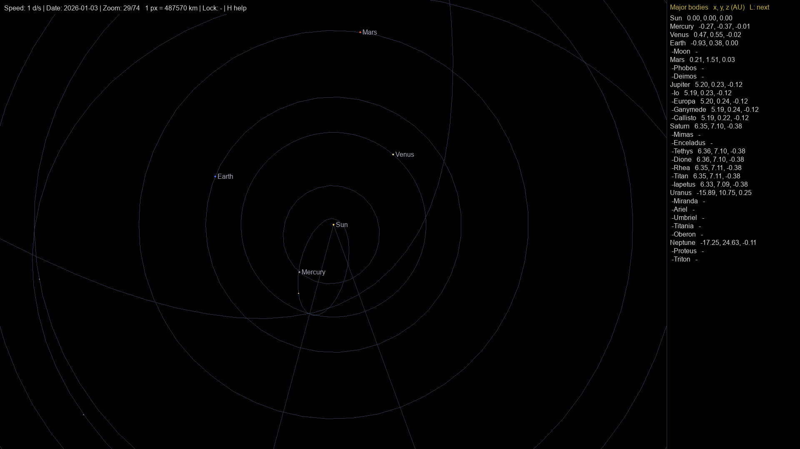

# Solar System

A zoomable, top-down model of the Solar System, written in
[BazzBasic](https://ekbass.github.io/BazzBasic/). The Sun, the planets and
their main moons, dwarf planets, asteroids, distant TNOs, Halley's Comet, the
ISS, Hubble, JWST, the Parker Solar Probe and both Voyagers (49 bodies) move
on their orbits while you zoom from Sedna's huge orbit all the way down to the
ISS circling Earth.



It is not exact science. Sizes, distances and periods are rounded textbook
values. The goal is that it looks right and runs smoothly.

## Run it

```
BazzBasic.exe "<path>\solar.bas"
```

You can also open `solar.bas` in the BazzBasic IDE and press F5. You need
BazzBasic 1.8 or newer (for mouse wheel support). The program opens a
1920 x 1080 window. The model starts on 1 January 2026 and runs at
1 day per second.

### Selftest

```
BazzBasic.exe "<path>\solar.bas" selftest
```

The selftest prints a few checks to the console (body count, calendar, orbit
maths, list order). Then it shows 14 fixed views for 120 frames each and
closes by itself. It writes these files:

- `selftest\report.txt`: what was drawn and the frame times for each view
- `selftest\phases.txt`: the time each drawing step takes
- one PNG picture per view

## Controls

| Input | Action |
|---|---|
| Mouse wheel | Zoom in or out at the cursor (75 steps). Over the body list it scrolls the list |
| Left-drag | Pan (this also unlocks the camera) |
| Left-click | Lock the camera on a body (see below) |
| C | Unlock |
| L | Body list: Off, Major, Other, Off |
| Click a list row | Lock on that body and zoom to it |
| F or Num+ | Faster |
| S or Num- | Slower |
| Space | Pause / continue |
| H | Show or hide the help line |
| Esc | Quit |

Speeds (simulated time per real second): paused, 1 h/s, 1 d/s, 1 wk/s,
1 mo/s, 1 yr/s, 10 yr/s, 100 yr/s.

### Clicking a body

A click picks the body whose **centre** is nearest the cursor, within
20 pixels. Before you click, that body's name lights up in yellow, so you can
see what you will get. On a big disc, click near its centre. A click far from
every centre unlocks the camera.

A locked camera follows the body. At deep zoom you need it: without a lock,
Earth would leave the screen in a blink.

## HUD

The line at the top left shows:

- **Speed**: the current time speed
- **Date**: the simulated date. When paused or at 1 h/s, the time (hh:mm) too
- **Zoom**: the zoom step (0 = widest, 74 = closest) and the scale, that is,
  how many km (or AU) one pixel is
- **Lock**: the locked body, or `-`

The help line at the bottom appears when you press H, and always while the
model is paused.

## The body list (L)

The list opens at the right edge of the window. While it is open, the model
moves left so the locked body is not hidden. Bodies under the panel cannot be
clicked.

- **Major**: the Sun and the planets in order from the Sun. Each planet's
  moons are indented under it (` -Moon`), nearest first.
- **Other**: everything else, ordered by distance from the Sun: Parker, ISS,
  Hubble, JWST, the asteroids, the dwarf planets, Halley, the TNOs and the
  Voyagers. Charon is indented under Pluto. ISS, Hubble and JWST sort by
  Earth's distance and the Voyagers by their distance on the start date, so
  the order never changes while the program runs.

Each row shows the name and **x, y, z**: the position seen from the Sun, in AU
(1 AU = the distance from the Earth to the Sun), with 2 decimals. x and y lie
in the plane of Earth's orbit, and z is the height above it (negative =
below).

A `-` instead of numbers means the body is indented under its parent and its
position is the same as the parent's at 2 decimals. This is true for most
moons in the Major list, and for Charon under Pluto. The ISS, Hubble and JWST
are not indented (Earth is in the other list), so they always show their
numbers. We do not print 15-decimal numbers on screen.

Click a row to lock on the body and zoom to it. For a planet with moons, the
whole moon system fits on screen. Any other body is drawn about 200 px wide,
or as close as the zoom goes for tiny ones.

## What is modelled and what is simplified

- **3D orbits, drawn from above.** Every orbit around the Sun is a tilted
  ellipse (inclination, ascending node and perihelion, rounded textbook
  values). The picture is the view from straight above, so tilted orbits look
  as they should from there. The height is the z value in the list.
- **Start positions** are display values that look good. They are not the
  real positions on 1 January 2026. The exceptions are Halley and Parker:
  they start from their real perihelion dates.
- **Sizes** are to scale. The smallest bodies are drawn as a 1 to 2 px dot so
  that nothing vanishes.
- **Moons** move on circles around their parent and always have the same z as
  the parent. Triton and Halley move backwards (retrograde).
- **JWST** sits 1.5 million km beyond Earth on the Sun-Earth line (the L2
  point) and moves with Earth. A small halo wobble is added.
- **The Voyagers** do not orbit. They fly in a straight line away from the
  Sun, and their distance grows steadily with time (Voyager 1 above the plane
  of Earth's orbit, Voyager 2 below). A faint line from the Sun shows their
  path.
- Bodies do not pull on each other. Each one follows its own fixed orbit.

## Add a body

All bodies are in `include\bodies.bas`, in the `[bodies:data]` section, one line
each. To add a body, copy a line and change it. For example, Saturn's moon
Hyperion:

```
    raw$(nRaw$) = "Hyperion  | Saturn    | moon     |    135 | 1481010 | km | 21.28  | d   | 0     | MOON_BEIGE |  1 |      0 |     0 |     0 |    90" : nRaw$ += 1
```

A line has 15 fields, separated by `|`. Spaces do not matter.

| # | Field | Meaning |
|---|---|---|
| 1 | name | Shown in the list and on labels |
| 2 | parent | The body it circles. It must be on a line above. The Sun has `-` |
| 3 | kind | `star`, `planet`, `moon`, `station`, `l2`, `dwarf`, `asteroid`, `tno`, `comet`, `probe` or `voyager` |
| 4 | radius | In km |
| 5 | a | Size of the orbit (semi-major axis) |
| 6 | unit of a | `AU` or `km` |
| 7 | period | Time for one orbit |
| 8 | unit of period | `d` (days) or `y` (years). Voyagers use `AUy` |
| 9 | e | Eccentricity: 0 = circle, near 1 = long, thin ellipse |
| 10 | colour | A colour name from `[inits:colors]` in `solar.bas`, such as `MOON_GREY` or `ASTEROID`. For a new colour, add a `pal$` line there |
| 11 | direction | `1` normal, `-1` backwards (retrograde) |
| 12 | i | Inclination in degrees |
| 13 | Om | Longitude of the ascending node in degrees |
| 14 | w | Argument of perihelion in degrees |
| 15 | start | Start angle in degrees on 1 January 2026 |

Moons and stations use `0` for fields 12 to 14.

Two kinds work differently:

- `voyager`: a = the distance from the Sun on 1 January 2026 in AU,
  period = the speed in AU per year (unit `AUy`), i = the direction's
  latitude, Om = the direction's longitude. Use `0` for e, w and start.
- `l2` (JWST): a = the distance beyond the parent on the Sun-parent line, in
  km, period = the halo period, start = the halo phase.

Stars, planets and moons of planets go to the Major list. Everything else goes
to Other.

If a line is wrong (a missing field, an unknown colour or an unknown parent),
the program stops at start-up and prints a message that names the line or the
body.

## Files

- `solar.bas`: start here (window, keys help, colours, main loop)

The rest are in the `include` folder; `solar.bas` brings them in with `INCLUDE`:

- `bodies.bas`: the body data and its loader
- `sim.bas`: orbit maths
- `view.bas`: input, camera, drawing, the body list
- `calendar.bas`: date functions
- `selftest.bas`: the selftest
